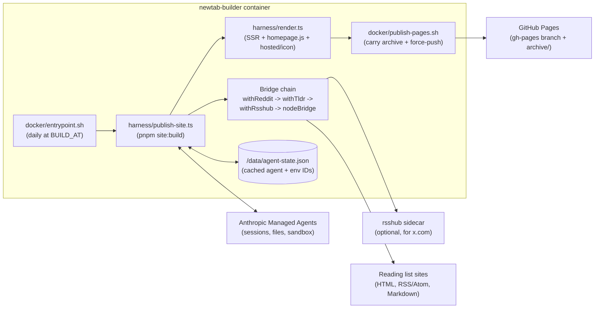
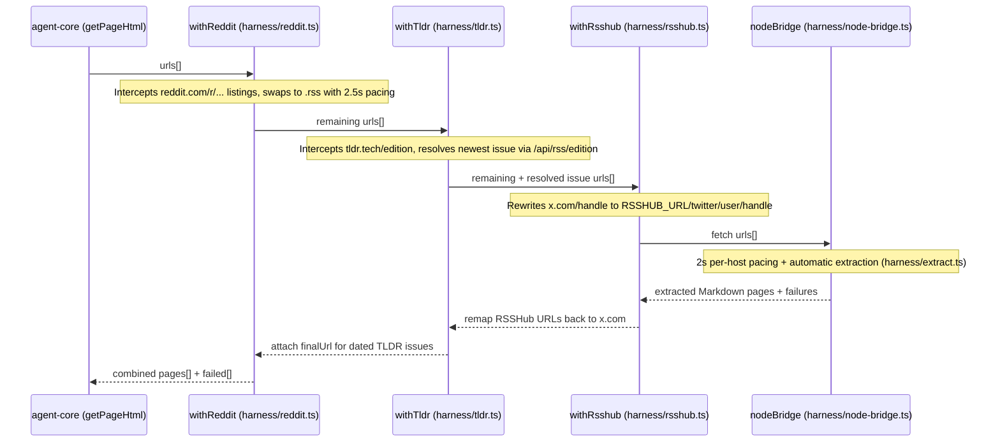
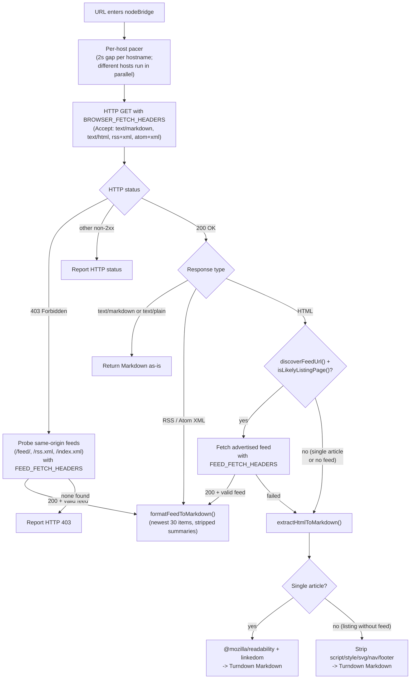

# Hosted Build Architecture

The hosted build turns `hosted/reading-list.txt` and `hosted/instructions.md` into a static daily edition (*The Context*) and publishes it to the repository's `gh-pages` branch, with every past edition preserved under `archive/YYYY-MM-DD/`.

Unlike the Chrome extension in [ARCHITECTURE.md](../ARCHITECTURE.md), the hosted container has no browser profile and no browsing history. It runs on a schedule (default `06:00` container local time), fetches every source anonymously, and drives the same `packages/agent-core` Managed Agents loop.

## End-to-End Flow



### Key invariants

- **Failed builds are non-destructive:** `docker/entrypoint.sh` only runs `publish-pages.sh` if `pnpm site:build` exits `0`. Any API or render error leaves yesterday's edition live on `gh-pages`.
- **Single-commit `gh-pages` with growing archive:** `publish-pages.sh` shallow-clones the existing `gh-pages` branch to carry forward `archive/`, archives the previous `index.html` + `homepage.js` under its `built-at` date, writes today's copy to `archive/YYYY-MM-DD/`, regenerates `archive/index.html`, and force-pushes a single fresh commit.
  - **Carry-forward only happens when the clone succeeds.** The clone runs as an `if` condition with stderr discarded, so the script cannot tell a missing `gh-pages` branch (first publish, which correctly starts an empty archive) from a failed clone (network or deploy-key error). In the failed-clone case it publishes only today's edition, and the force-push replaces `gh-pages` without the earlier `archive/` editions.
- **No internal addresses leak to the model:** `withRsshub` rewrites `https://x.com/<handle>` to `$RSSHUB_URL/twitter/user/<handle>` at fetch time and maps results and errors back to `https://x.com/<handle>` before returning to `agent-core`.

## Bridge Chain

`harness/publish-site.ts` composes four `BrowserBridge` layers. Each wrapper intercepts only the URLs it owns and passes everything else down to `nodeBridge`:



| Layer | File | Handles | Why it exists |
| --- | --- | --- | --- |
| `withReddit` | `harness/reddit.ts` | `reddit.com/r/<subs>/<sort>` | Anonymous `.json` returns `403` and HTML is a login wall; `.rss` returns the top posts. Paced at 2.5s per host to avoid `429` bursts. |
| `withTldr` | `harness/tldr.ts` | `tldr.tech/<edition>` | Section URLs are signup pages; the bridge reads `/api/rss/<edition>` and fetches the newest dated issue URL instead. |
| `withRsshub` | `harness/rsshub.ts` | `x.com/<handle>` | X requires sign-in; routes through a private RSSHub container without exposing its URL to the agent or blocklist. |
| `nodeBridge` | `harness/node-bridge.ts` | Everything else | General-purpose fetcher with 2s per-host pacing and automatic content extraction (`harness/extract.ts`). |

## Automatic Content Extraction (`harness/extract.ts`)

`nodeBridge` does not maintain a hardcoded per-site feed map. For every URL it fetches, it automatically negotiates the cleanest representation and converts it to compact Markdown (capped at 120 KB) before uploading to the agent sandbox:



### Why two User-Agent profiles exist

- **`BROWSER_FETCH_HEADERS`** is used for initial HTML requests (with `Accept: text/markdown, text/html;q=0.9, ...`).
- **`FEED_FETCH_HEADERS`** (`homepage-builder/1.0 (personal daily digest)`) is used when fetching discovered or probed RSS/Atom feeds. Bot-mitigated hosts (such as Cloudflare) frequently `403` spoofed Chrome User-Agents that lack a matching browser TLS fingerprint, while allowing honest RSS reader User-Agents on `/feed/`.

### Listing vs. article detection (`isLikelyListingPage`)

An HTML page prefers its advertised `<link rel="alternate" type="application/rss+xml|atom+xml">` feed (skipping comment feeds) when:

1. The discovered feed path directly extends the page's own path (e.g. `/anthropics/claude-code/releases` -> `/anthropics/claude-code/releases.atom`, or `/category/artificial-intelligence/` -> `/category/artificial-intelligence/feed/`, even when WordPress/Yoast sets `og:type=article` on category archives); or
2. The page is not marked `og:type=article` and either has 3+ `<article>` elements or a short root/section path.

Single articles skip feed replacement and go straight through `@mozilla/readability` + `turndown` with relative `<a href>` links resolved to absolute URLs.

## Deployment & Configuration

`.github/workflows/image.yml` builds `docker/Dockerfile` on every push to `main` and publishes `ghcr.io/<owner>/<repo>:main`.

| Variable | Required | Default | Purpose |
| --- | --- | --- | --- |
| `ANTHROPIC_API_KEY` | Yes | — | Anthropic API key for Managed Agents (`sessions`, `files`, `events`) |
| `PAGES_REPO` | Yes | — | Target GitHub repo (`owner/repo`) whose `gh-pages` branch is published |
| `DEPLOY_KEY_B64` | Yes | — | Base64-encoded SSH deploy key with write access to `PAGES_REPO` |
| `RSSHUB_URL` | No | — | Internal RSSHub base URL (e.g. `http://rsshub:1200`) for `x.com` handles |
| `BUILD_AT` | No | `06:00` | Daily build time in container local time (`TZ`) |
| `RUN_ON_START` | No | `false` | Run a build immediately on container startup before entering the daily loop |
| `HOMEPAGE_MODEL` | No | Sonnet | Override the model ID from `MODEL_CHOICES` |
| `AGENT_STATE_PATH` | No | `/data/agent-state.json` | Persists cached Anthropic agent and environment IDs across builds |

## Local Verification

```bash
pnpm test                              # Unit tests (no API calls; includes extract.test.ts)
pnpm --filter @homepage/harness typecheck
ANTHROPIC_API_KEY=... pnpm site:build  # Full hosted build into site/
```
